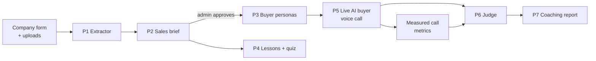
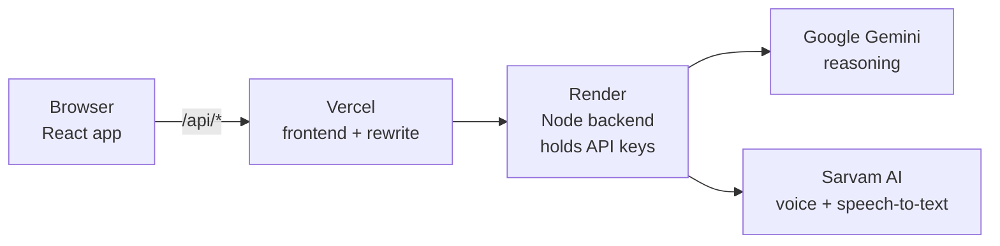

# Coach: an AI sales trainer

**New salespeople practise live voice calls against realistic AI customers, and get a scored report after every call.**

A company describes what it sells and how. Coach turns that into a complete training programme: a sales playbook, AI buyers to practise on, lessons, a quiz, and a judge that scores every call against the company's own rules.

**Live app:** https://coach-six-tau.vercel.app &nbsp;·&nbsp; **Design spec:** [sales-coach-spec.md](sales-coach-spec.md)

> Designed, built and deployed solo, from idea to a working product: product spec, prompt design, frontend, backend, voice pipeline and deployment.

---

## The problem

Companies that sell over the phone, such as edtech, SaaS, insurance and real estate, hire new sales reps constantly. Those reps learn by shadowing calls and by role-playing with a manager. That approach has three problems:

- **It doesn't scale.** Every role-play takes a manager's time, so reps get little practice before they're put on real calls.
- **It's inconsistent.** Feedback depends on which manager runs the session and on how they feel that day.
- **Mistakes happen on real customers.** A rep who promises guaranteed results or an unapproved discount costs a real deal, or creates a compliance problem.

## What Coach does

| Who | What they do | What they get |
|---|---|---|
| **Sales manager / admin** | Fills one form about the company (product, pricing, buyers, objections, rules) and uploads decks, PDFs or call recordings | A reviewed **sales brief**, AI buyer personas, lessons and a quiz, all generated from their own material |
| **Sales rep** | Studies the lessons, then talks to an AI customer by voice | A **scored report**: what they missed, which rules they broke, and stronger lines to say next time |
| **Manager (again)** | Opens the team view | Who is ready for real calls, and where the whole team is weak |

## By the numbers

| | |
|---|---|
| **7** | AI prompt stages, from company data to final report (P1–P7) |
| **10** | sales stages on the scorecard, from pre-call prep to next steps |
| **12** | call metrics measured from the audio (talk ratio, longest monologue, pace, interruptions…) |
| **4** | buyer difficulty levels, from a warm lead to a hostile buyer who sets compliance traps |
| **5** | practice modes: full call, opening, discovery, objection gauntlet, closing |
| **~₹4** | voice cost of a 10-minute practice call. The AI thinking runs on Gemini's free tier |
| **~4–5 s** | from the rep finishing a sentence to the AI buyer starting to speak |

## How it works



| Stage | What it does |
|---|---|
| **P1 Extractor** | Reads the form, PDFs, Word files and call recordings, and turns them into structured knowledge. Flags missing information and contradictions. |
| **P2 Sales brief** | Writes the single source of truth: target customers, the discovery checklist, objection library, pricing rules, compliance rules and a weighted scorecard. **A human approves it** before anyone trains on it. |
| **P3 Buyer personas** | Creates buyers, each with a *visible lead card* and a *hidden truth* (real pain, budget, who decides, hidden objection) that the rep has to uncover. |
| **P4 Lessons + quiz** | One lesson per sales stage, plus a 15-question quiz written from the brief. |
| **P5 Live AI buyer** | Holds the voice conversation. It tracks its trust in the rep, reveals facts only when asked good questions, raises objections, and ends the call the way a real person would. |
| **P6 Judge** | Scores every stage against the company's rubric. **Every score must cite a quote from the call.** Also checks compliance, fact-checks product claims, and rewrites the rep's weakest lines. |
| **P7 Report writer** | Turns the judge's output into a short coaching summary and recommends the next practice drill. |

### What makes the practice realistic

- **Hidden information.** The buyer has facts the rep must uncover. The report shows exactly which ones were found and which were missed, which makes "discovery" measurable.
- **A trust score** that moves during the call and is drawn as a chart in the report, so the rep can see the moment they lost the buyer.
- **The buyer acts like an outsider.** It can't mention prices, plan names or policies until the rep says them.
- **No easy wins.** Whether the buyer is *allowed* to buy is decided in code, not by the AI. Expert buyers never buy on a first call, and others need sustained trust, uncovered needs and resolved objections.

### What is scored, and what deliberately isn't

The judge scores only **observable behaviour**: what the rep asked, claimed and promised, and in what order. It does **not** score tone, empathy or confidence, because a transcript can't measure those reliably. Every score is either measured from the audio or backed by a quote from the call.

## Built by testing it on real calls

I tested the product by doing practice calls myself as a sales rep (selling BYJU'S courses to AI parents) and fixed what broke. Each fix below came from a real call transcript:

| What went wrong in testing | Root cause | Fix |
|---|---|---|
| The AI buyer corrected the rep about "CBSE" when the rep had never said CBSE, and mentioned "the 2-year plan" before it was offered | The buyer's prompt contained insider product details | Gave the buyer an outsider's knowledge only, plus a **check in code** that rewrites any line using prices, plan names or durations the rep hasn't said yet |
| A hostile buyer agreed to pay on the first call after one good answer | Buying was left to the model's judgement | A **purchase rule in code** (trust, uncovered needs, resolved objections, call length). Trust can rise by at most 1 point per turn |
| The buyer said "at least you're being honest", which real customers rarely say | The model drifted into coaching the rep | Comments about the rep are detected in code and the line is rewritten |
| A call ended mid-conversation, right after the buyer set a condition | The model marked "willing to see a demo" as the end of the call | A call can now end only on a real goodbye or brush-off, checked in code |
| Long answers failed to transcribe | Speech-to-text accepts at most 30 seconds | Audio is split at its quietest points and the pieces are transcribed in order |
| Pages crashed when the cheaper model skipped part of an answer | The code assumed every field would be present | Every AI output is cleaned and given defaults before the screens use it |

**The lesson:** with a small, cheap model, prompts alone aren't reliable. The rules that matter most are enforced in code, and the model is asked to rewrite its reply when it breaks one.

## Architecture



- **Frontend:** React + TypeScript + Vite, deployed on **Vercel**. Live voice turn-taking runs in the browser: it detects when the rep stops talking and when they cut the buyer off.
- **Backend:** a small Node server on **Render** that holds the API keys. It forwards only the three calls the app needs and rate-limits each visitor, so a leaked link can't drain the free tiers.
- **AI:** Gemini 3.1 Flash-Lite for reasoning, Sarvam Bulbul v4 for the buyer's voice (Indian English and Hinglish voices), and Sarvam Saaras v4 for speech-to-text.
- **Resilience:** automatic retries when Gemini is overloaded, with a fallback to a second model.

**Why these choices:** I picked the cheapest models that worked and made the product robust around them, rather than relying on an expensive model to behave. That keeps a practice call at roughly ₹4.

## How I'd measure impact

These are the metrics I'd track with a real sales team. They aren't measured yet:

- **Time to readiness:** days until a new rep passes certification calls against hard buyers.
- **Practice volume:** calls per rep per week, compared with role-plays they'd get from a manager.
- **Skill movement:** change in each stage score over time (discovery, objection handling, closing).
- **Compliance:** critical violations per 100 practice calls, and whether it falls over time.
- **Real-world link:** whether reps' practice scores predict their conversion rate on real calls.

## Future scope

- **A customer support coach,** using the same engine with different personas: angry customers, refunds, escalations.
- **Learning from real calls:** import recordings from dialers such as Exotel and Ozonetel, or from Zoom and Gong, and score them with the same rubric.
- **Certification:** a fixed exam of hard buyers that marks a rep "ready for real calls", with manager sign-off.
- **Team accounts and a shared backend,** so managers see every rep's progress in one place instead of per browser.
- **Hindi and regional-language practice,** where Sarvam's Indian-language voices give it an edge for Indian sales teams.
- **Other training areas:** interviewer training, new-manager conversations, compliance training for banking and insurance, and partner enablement.

## Current limitations

- Each browser keeps its own data (there is a download/load workspace option). A database and user accounts are the next step.
- About 4–5 seconds of delay between turns: speech-to-text, then reasoning, then voice, one after another.
- Render's free plan sleeps when idle, so the first request after a quiet spell takes about 50 seconds.
- Tone and empathy are intentionally not scored.

## Run it locally

```bash
cd app
npm install
npm run dev
```

Create `app/.env.local` with `GEMINI_API_KEY=...` and `SARVAM_API_KEY=...` (see `app/.env.example`), then open http://localhost:5173 in Chrome with headphones. On the Company page, **Fill with sample B2B SaaS company** gives you a complete example to try.

## Deployment

- **Backend (Render):** `render.yaml` defines the `coach-api` service from `server/`. Set `GEMINI_API_KEY` and `SARVAM_API_KEY` in the Render dashboard.
- **Frontend (Vercel):** project root `app/`. `app/vercel.json` forwards `/api/*` to the Render service, so the browser never sees the keys.

## Repository structure

```
app/                  React frontend
  src/prompts/        the 7 prompt stages (p1-extractor … p7-report)
  src/lib/            AI client, voice engine, audio splitting, metrics, storage
  src/pages/          screens: company, brief, buyers, lessons, practice, call, report, team
server/               Node backend that holds the API keys
render.yaml           Render deployment
sales-coach-spec.md   product spec: sales lifecycle, scoring design, prompt pipeline
```

---

Built by **Ayush Das** · [github.com/xayushdasx](https://github.com/xayushdasx)
